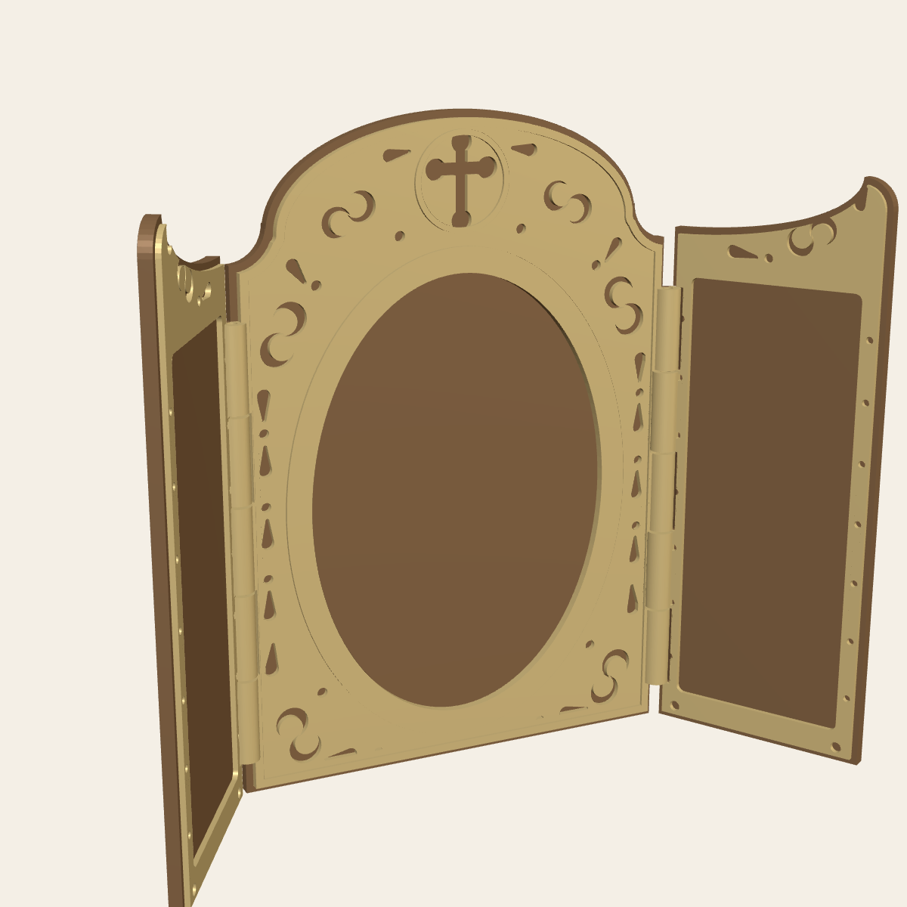
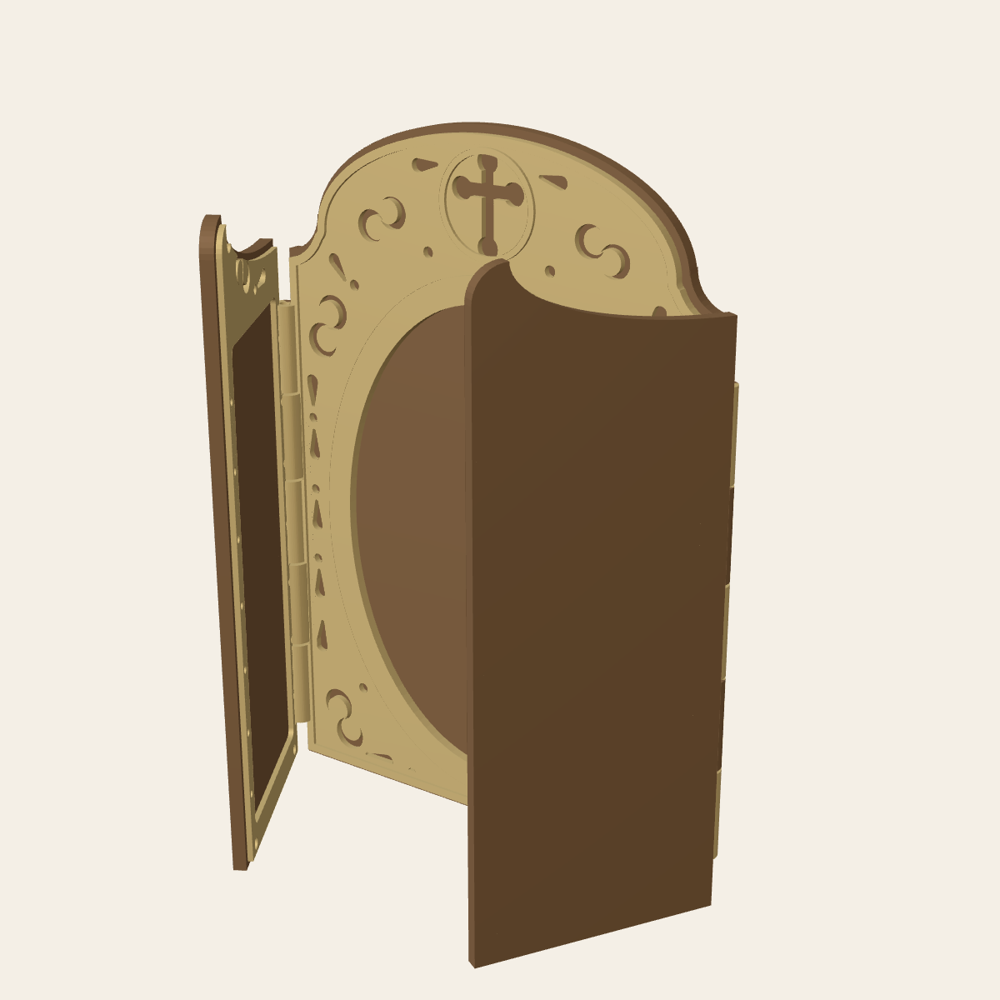
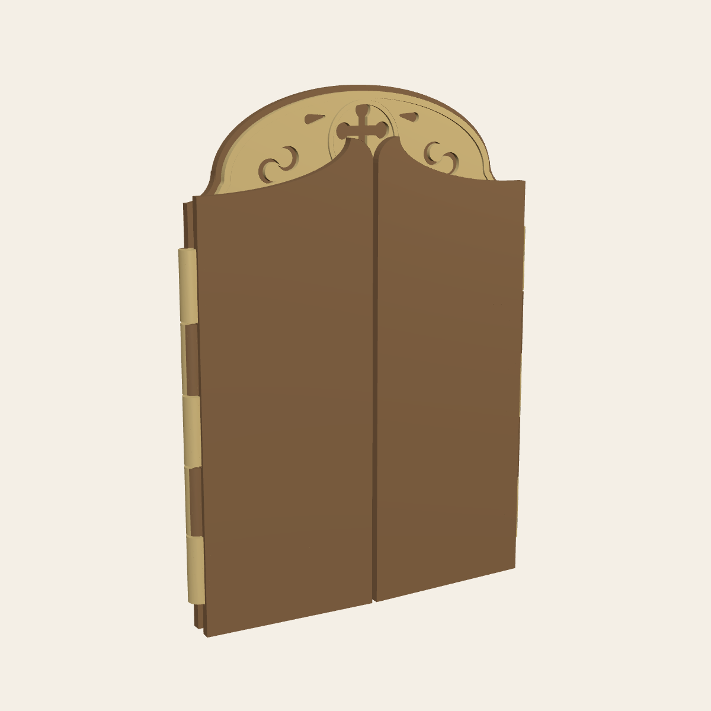

# Capela Tríptico — impressão 3D

Oratório de bolso no estilo do modelo das fotos: um painel central com moldura rendada, cruz e oval para a imagem, mais duas portas laterais. As portas abrem e fecham por **dobradiças de pino**, e quando fechadas se encontram no meio, por cima do painel central.

| Aberta | Fechando | Fechada |
|---|---|---|
|  |  |  |

## Medidas

| Peça | Largura × altura | Espessura |
|---|---|---|
| Centro | 90 × 128 mm (96 mm contando as dobradiças) | 4,2 mm (6,6 mm na dobradiça) |
| Cada porta | 44,5 × 116 mm | 3,4 mm |
| Aberta (plana) | 192 × 128 mm | — |
| Fechada | 96 × 128 × ~9 mm | — |

## Arquivos

- `stl/centro.stl`, `stl/porta_esq.stl` e `stl/porta_dir.stl`: as peças separadas.
- `stl/placa.stl`: as três peças numa mesa só (192 × 128 mm, cabe em mesas de 220 × 220 mm ou maiores).
- `capela.scad`: o modelo paramétrico em OpenSCAD. Dá para mudar tamanhos, folgas e diâmetro do pino.
- `molde_imagens_A4.pdf`: molde em tamanho real para recortar as imagens (oval de 61 × 87 mm e portas de 35 × 87 mm).

## Como imprimir

- Imprima **deitado, com a face decorada para cima**. Não precisa de suporte.
- Camada de 0,16 a 0,2 mm, 3 perímetros e 20 % de preenchimento. PLA ou PETG.
- **Efeito dourado (opcional):** comece com filamento marrom e troque para dourado ou "silk gold" na altura de **2,4 mm**. No Cura, use "Pause at height"; no PrusaSlicer ou no Bambu Studio, use "Add color change" nessa camada. A base fica marrom e o rendado e a moldura ficam dourados, com o marrom aparecendo pelos vazados, como na peça original.

## Como montar as dobradiças

1. Encaixe a porta ao lado do centro, alinhando os nós (barris) da dobradiça.
2. Passe um **pedaço de filamento de 1,75 mm** com cerca de 86 mm pelo furo de baixo para cima. O furo tem 2,0 mm. Também serve arame ou um prego fino de 1,8 a 2 mm.
3. Para travar, aqueça as pontas do filamento com um ferro de solda ou isqueiro e amasse, ou ponha uma gota de cola nas pontas. Não coloque cola no meio, senão a dobradiça trava.
4. Se a dobradiça ficar dura, passe uma broca de 2 mm no furo.

A folga foi verificada no modelo de 0° a 180°: as peças não se tocam em nenhum ângulo. A porta fechada fica 0,4 mm acima do relevo do centro.

## Imagens

Imprima `molde_imagens_A4.pdf` em **100 %** e confira a régua de 100 mm. Cole as imagens (a crucificação no oval, os anjos ou outras imagens nas portas), recorte e cole no rebaixo de cada peça. Para dar o acabamento "vidro" da foto, cubra com resina epóxi ou com um adesivo de vinil transparente.

## Ajustes no `capela.scad`

| Parâmetro | Padrão | Para que serve |
|---|---|---|
| `PIN_D` | 2.0 | diâmetro do furo do pino |
| `R_kn` / `R_notch` | 2.6 / 3.1 | raio do barril / raio da folga ao redor dele |
| `G_KN` | 0.5 | folga entre os nós da dobradiça |
| `c_gap` | 0.3 | metade da folga entre o centro e a porta |
| `Wc`, `Hc_top` | 90, 128 | largura e altura do centro (as portas acompanham) |

Para exportar uma peça: `openscad -D 'PART="centro"' -o centro.stl capela.scad`. As opções são `centro`, `porta_esq`, `porta_dir`, `placa`, `aberta` e `fechada`.
